# logh3 — 銀河英雄傳說III SP DOS remake／研究專案

《銀河英雄傳說III SP》（Legend of the Galactic Heroes III SP）PC DOS 中文版的
重製與保存專案。原版 1993 年由 BOTHTEC／QUEST 與 Micro Vision 製作，
1994 年由亨和企業．微波軟體發行中文版。

專案有兩個並行的目的：把遊戲重做成可維護的版本，以及保存這款 1994 年台灣
中文化作品的技術細節——原始碼與開發資料都不存在，只剩執行檔可以問。

## 現在做到哪裡

下面八張都是 **remake 自己畫的**——Go 寫的繪製器 ＋ 玩家自備的原版素材
（字型、星域圖、頭像），走正常玩家路徑，不是直接開畫面。每一張都與原版在
無頭執行器裡跑出來的收據**逐位元組相同**（0 個像素不同），
用 `tools/readme_shots.sh` 產生：比不過收據的圖不會被寫出去。

| 主選單 | 防拷問答 |
|---|---|
|  | 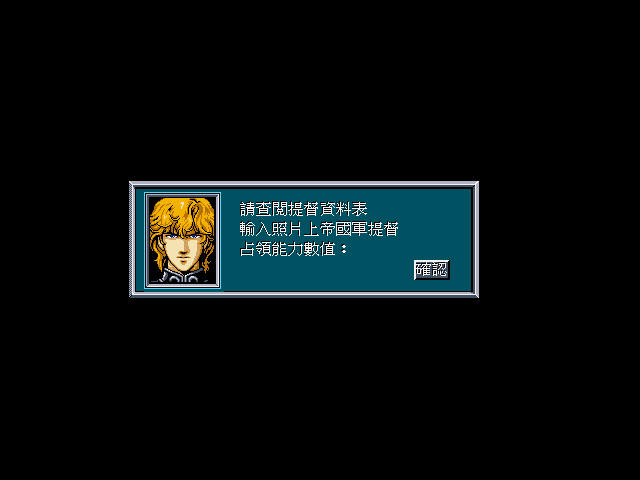 |
| 收據 `r0` | 收據 `cb1` |

| 月初報告 | 戰略地圖介面 |
|---|---|
| 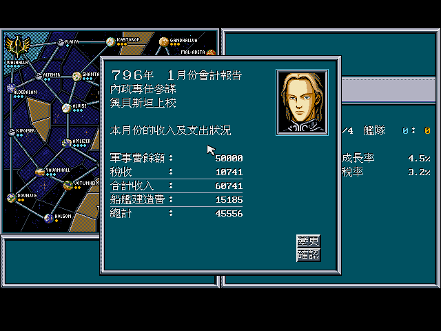 | 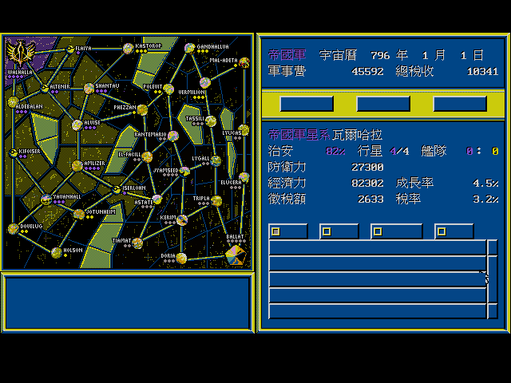 |
| 收據 `key1` | 收據 `main1e` |

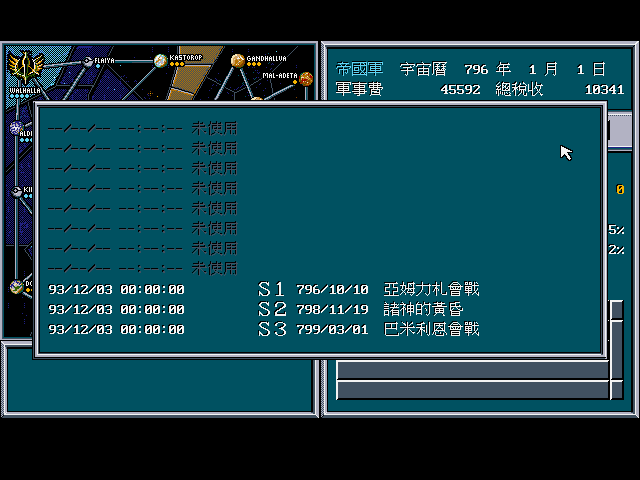

「取進度」那 11 列不是量好畫死的——存檔時間、序號、遊戲內日期與名稱都從
`SAVEDATA.IDX` 算出來（收據 `load1e`，整張逐位元組相同）。

| 戰略情報報告 | 提督資料 |
|---|---|
| 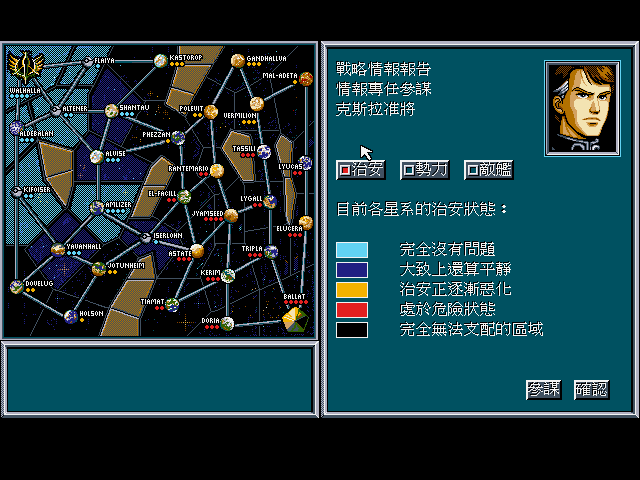 | 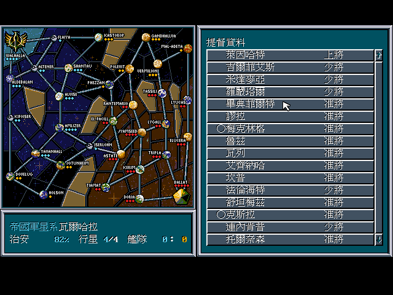 |
| 收據 `info1e` | 收據 `lst2e` |

左邊那張的星域圖跟著**治安**換色（不是勢力色），頭像來自 `FACE.AMG`。
右邊那張十六列的姓名、軍階與幕僚職記號全部從 `ADMIRAL.DT*` 與 `WORK` 算出來，
規格裡只有版面。

| 提督詳細資料 | 提督經歷（人物傳）|
|---|---|
| 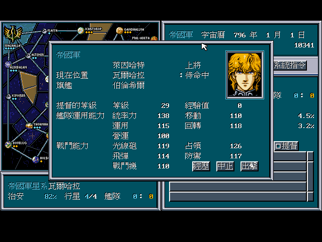 | 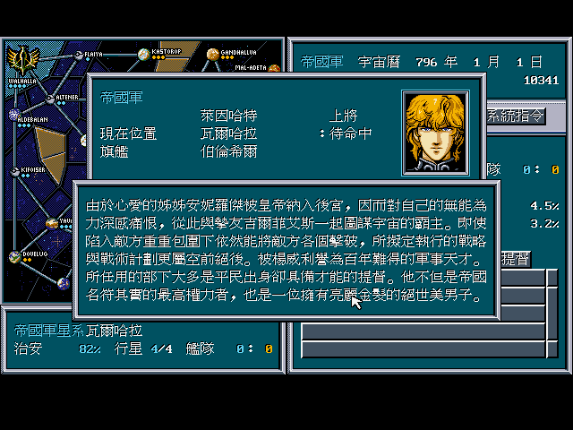 |
| 收據 `adm1e` | 收據 `keireki1e` |

出擊命令的待命中提督清單點一位提督就到這裡。這張畫面把 `ADMIRAL.DT*`
十四個能力欄位裡的十個標了名字——統率力、移動、回轉、營運、光線砲、
飛彈、戰鬥機、防禦、占領、運用——逆向到這一步之前那幾格只知道
「值域 80–140」（[`docs/re/65`](docs/re/65-admiral-detail-screen.md)）。
旗艦查的是執行檔資料段裡兩張各 16 筆的對照表。

右邊那張是「經歷」開出來的**人物傳**，內容逐字取自原版 `KEIREKI.DAT`，
中譯是當年微波軟體的中文化工程；82 篇的可讀版本在
[`docs/lore/character-biographies.md`](docs/lore/character-biographies.md)。

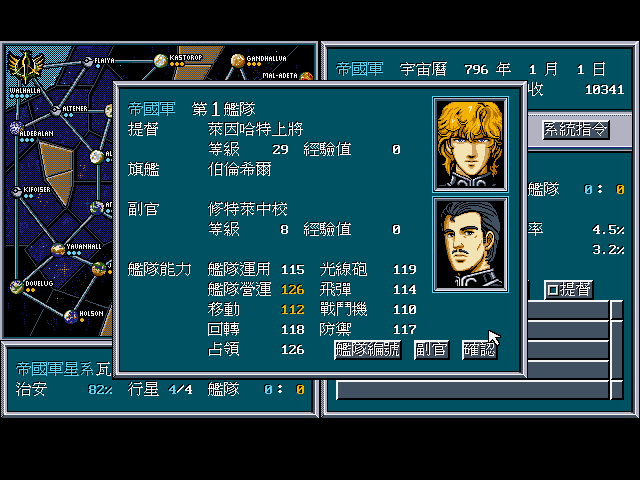

詳細資料按「出擊」開出**艦隊編成**（收據 `fleet1e`）。九格艦隊能力不是
提督自己的值，是提督與副官合成的——而且副官贏的那幾格印成另一個顏色，
畫面自己把「這一格是副官撐起來的」標了出來
（[`docs/re/66`](docs/re/66-fleet-organisation-screen.md)）。
合成方式前五項與後六項不同：前五項副官只把值往上拉一半
（`(提督＋副官) ÷ 2`），後六項才是逐項取大——拿三格原版存檔對，
62 支艦隊 682 個值全對（[`docs/re/91`](docs/re/91-fleet-ability-blend.md)）。
副官是 `ADMIRAL.DT*` 記錄裡的 `+0x07`，`0xFF` 同時代表這位提督
沒有旗艦、帶不了艦隊。

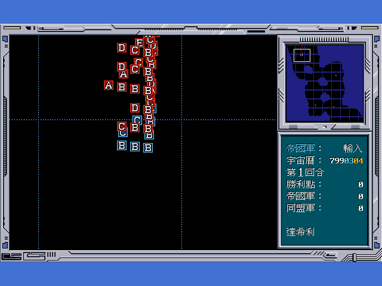

雙方的艦隊走到同一個星域就切進**戰術畫面**。這張是走正常玩家路徑拍的：
主選單開新遊戲 → 戰略地圖介面 → 系統指令／取進度 → 第 10 格
「巴米利恩會戰」→ 選帝國 → 實行。面板、地形、格線、右側狀態欄、
單位與小地圖五層都是從原版檔案重建的，整張畫面與原版收據
**逐位元組相同**（`TestBattleMatchesOracle`、`TestMinimapMatchesOracle`）
——這張圖本身沒有同狀態收據可比，因為 remake 的行軍速度還沒對到原版
（原版要按六次實行才會合）。

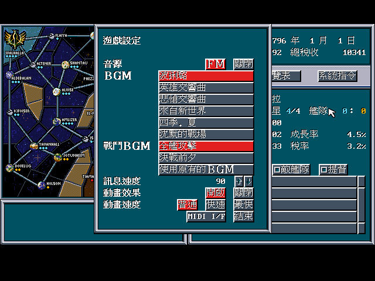

遊戲設定那張把字型層的兩個問題一次逼出來：曲名「波利路」用到 Big5 的
次常用字，而字型檔沒有存 `0xC6A1`–`0xC8FE` 那 408 個碼位；「MIDI I/F」
則是**兩個半形字塞在同一格**，不是全形（[`docs/re/51`](docs/re/51-settings-screen-two-font-bugs.md)）。

戰略地圖介面上的每一個數字也是算出來的：左下角的星域摘要、右側的日期與
兩筆錢、預算與生產計劃的四十幾個數字，全部從原版資料檔推到像素，
中間沒有抄來的值。

### 走得完的路

```
主選單 ─┬─ 帝國／同盟／對戰 ─→ 防拷問答 ─→ 月初報告 ─→ 戰略地圖介面
        └─ 取進度 ─→ 防拷問答 ─→ 存檔畫面 ─→ 選一格 ─→ 戰略地圖介面
```

視窗版（Ebiten）走得完同一條路：`tools/gui_check.sh` 把 Ebiten 畫出來的
色號陣列與原版收據逐位元組比，五張全中。

命令階段三格下拉選單、十二張子畫面、預算／生產計劃、結局畫面都畫得出來且
對過。一覽表的四張清單（提督、待命中提督、敵提督、星系）也是——十六列的
姓名、軍階、幕僚職記號與星域名全部從原版資料檔算出來，規格裡只有版面。
存檔可以讀也可以寫回去（六個檔逐位元組相同）。

**回合也走得動**：按一次「實行」推進三天，整張畫面與原版逐位元組相同；
第十次跨月時跳出「船艦接收報告」，十四個數字是上一份建造計劃買到的船，
署名的參謀由存檔算出來。

### 解出來的規則

| 主題 | 做到哪裡 |
|---|---|
| 月底結算 | 逐行星成長、兩種稅、造船扣款——796 年 1 月畫面上每一個錢都算得出來 |
| 未安定度 | 載入時整支算式解出來，三個局面 ×32 個星域**全中**；跨月不重算 |
| 星域表重算 | 新遊戲開局的擁有者、行星數、經濟力、成長率、民心、稅率、未安定度七項全中 |
| 存檔格式 | `*.DT[89A]` 就是執行期那幾張表；讀、寫、目錄都對過 |
| 曆法、路徑表、星域圖 | 已解 |
| 戰場畫面 | 640×480 逐位元組相同（面板、地形、格線、狀態欄、單位、小地圖五層）|
| 戰鬥 | 雙方走到同一星域就開戰；總損失以**行星**為中心算（防衛力、查詢半徑、距離衰減、方向係數、防禦係數、亂數），分攤、九回合上限與分數都照原版 |

完成度的數字看 [`VERIFICATION-MATRIX.md`](VERIFICATION-MATRIX.md)，
規格與狀態看 [`docs/spec/000-README.md`](docs/spec/000-README.md)。

## 還沒做的

- 開頭動畫的整段對拍：第 0 格、調色盤與頁面幾何都對上了，整段播不出原版
  順序——原版在第一次搬圖之前換過讀檔緩衝，第 1–116 格從來沒被解過
  （[`docs/re/108`](docs/re/108-intro-plane-buffers-located.md)、
  [`docs/re/116`](docs/re/116-intro-buffer-overlap-root-cause.md)）。要不要連那個瑕疵一起
  重現是忠實度取捨。
- 單擊的扣除量：算式、係數與分母 K 都解出來了（`docs/re/86`、`docs/re/94`），
  還沒把每回合的結算從艦隊層那條換成「照攻擊名單逐一開火」——卡在
  「誰寫艦艇記錄的攻擊時座標」。
- 戰略 AI 的座位順序：AI 本身已經接進回合流程（規格
  [`docs/spec/029`](docs/spec/029-strategic-ai-turn.md)），但原版是**逐座位**跑的
  ——帝國座位的月底結算在同盟座位的 AI 之前，而 remake 把 AI 放在回合最前面。
  回合 10 的同盟 `Blend` 因此兩邊不同（原版 2、remake 0）。
- 戰場的行星命令選單還沒對拍：四項行為都逆向過了，缺原版的行星命中判定。
- 音樂：22 首 `.MDS` 已經轉成 MIDI（[`docs/internals/17`](docs/internals/17-mds.md)），
  remake 還沒有播放層。

## 電腦 AI

兩套並存，**預設走原版**——原版按「實行」時電腦不下任何命令，這是量
出來的（`docs/re/79`：兩個局面十八回合，決定計數器一直是 0），不是缺
實作。強化版用 `-ai 0`–`3` 開，會挑一個目標、把艦隊集結到與目標相鄰的
我方星域、湊到兩個以上方向且兵力比達標才一起壓上去；兵力用的是**原版
自己的戰力算式**（`docs/spec/017`）。

## 五張清單為什麼一直是空的

這五張清單畫面在收據上長期是空的，一度被記成「原版在這個局面下就是空的」。
實際上資料一直都在：篩選器回了 11 筆提督，字元平面上名字與軍階也都在，
**是無頭執行器少了 VGA 的 read mode 1（color compare）**。

原版畫字用 write mode 3 ＋ read mode 1，color don't care 全 0，拿讀回的
`0xFF` 當全開的遮罩配 `and es:[di],al` 把字形寫進去。執行器回的是 plane 值，
遮罩就變成 `plane0 AND 字形`——底色所在 plane 是 0 的格子整個歸零，
字一個像素都不寫。所以底色色號 9 的標題畫得出來、底色 8 的名字畫不出來。

補上之後（dosgolem `35d4cc3`，spec 017），178 份收據裡有 155 份變了：
命令按鈕、確認鈕、分頁鈕、清單內容——大半個介面的文字本來都少畫了。
調查過程在 [`docs/re/49`](docs/re/49-lists-were-a-vga-read-mode-gap.md)，
字元平面的格式在
[`docs/internals/31`](docs/internals/31-text-plane.md)。

## 怎麼跑

需要自備原版遊戲檔（本儲存庫不含原版檔與素材），放在 `org_game/extracted/`。

```
tools/gui.sh build ./cmd/gin3                # 建 Ebiten 視窗版
tools/gui.sh run ./cmd/gin3 -orig /orig      # 玩（Ebiten）
tools/gui.sh run ./cmd/gin3 -orig /orig -ai 1   # 開強化版電腦 AI（0–3）
tools/gui_check.sh                           # 顯示層的同狀態驗收
tools/go.sh test ./...                       # 含對拍回歸測試
tools/go.sh run ./cmd/play -orig /orig -out /src/workplace/play \
  -pal /src/workplace/oracle/main1e/pal.bin \
  -script "move 300 210; click; type 138; enter; rclick 300 240; rclick 300 240"
tools/go.sh run ./cmd/oradiff \
  -oracle workplace/oracle/main1e/screen.bin -remake workplace/play/06-rclick-300-240.bin
```

原版側的畫面由 [dosgolem](https://github.com/wicanr2/dosgolem)（無頭、決定性的
DOS 執行器）產生，它是本專案唯一的 oracle。

上面那幾張 PNG 是 remake 的輸出，用原版字型與地圖畫的；原版檔案本身
不隨本儲存庫散布。

## 文件

| 檔 | 內容 |
|---|---|
| [`AGENTS.md`](AGENTS.md) | 協作規範與對拍契約 |
| [`CONTEXT.md`](CONTEXT.md) | 目前真相與唯一剩餘工作 |
| [`VERIFICATION-MATRIX.md`](VERIFICATION-MATRIX.md) | 完成度的唯一數字來源 |
| [`docs/spec/`](docs/spec/) | 規格：要照著做什麼與驗收條件 |
| [`docs/internals/`](docs/internals/) | 逆向出來的事實（格式、結構、演算法），含機器可讀的 `data/*.json` |
| [`docs/re/`](docs/re/) | 逐次調查紀錄 |
| [`docs/lore/`](docs/lore/) | 從遊戲裡抓出來的人物傳等文本 |
| [`docs/playtest/`](docs/playtest/) | 對拍收據 |
| [`WORKLOG.md`](WORKLOG.md) | 流水帳 |

## 授權

採用 **復古重製 source-available 授權條款 1.0（RRSAL-1.0）**：非商業用途免費，
含修改與再散布；實況、影片與平台分潤明示允許；商業用途要先洽談。
儲存庫目前是私有的，`LICENSE` 全文在轉公開之前補上。

原版遊戲檔與素材不屬於本專案，也不隨本專案散布。
