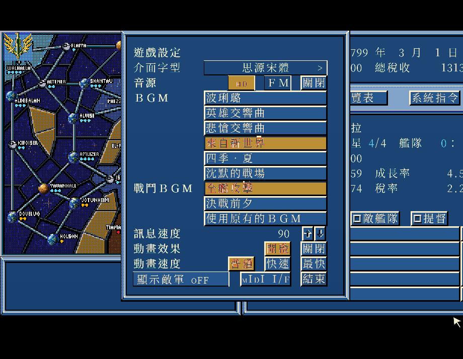
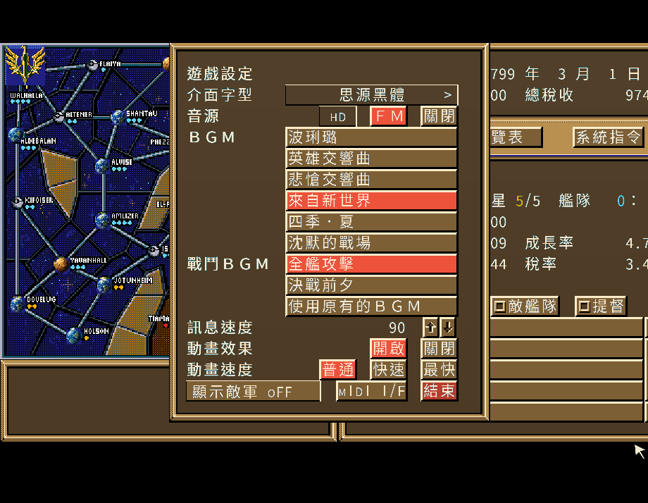
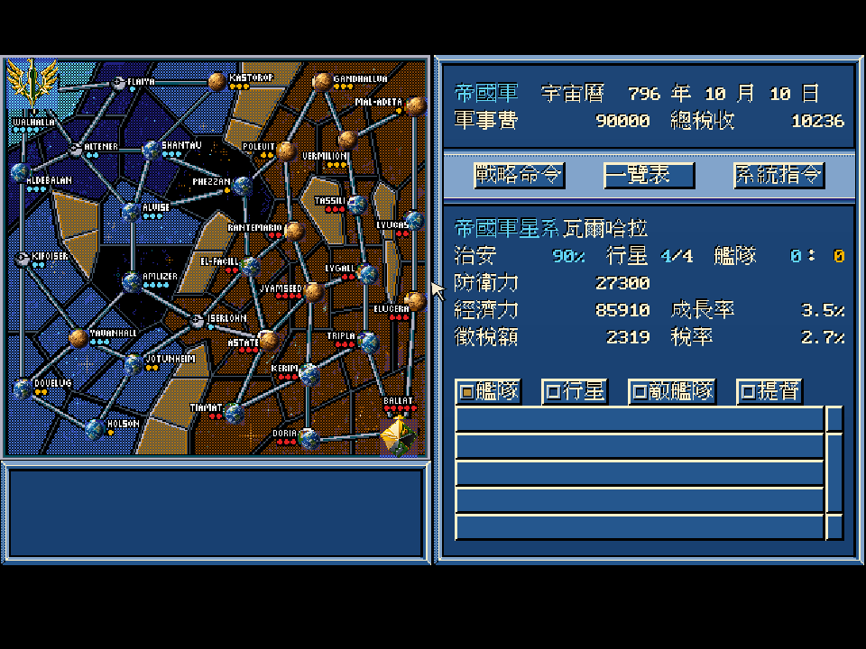
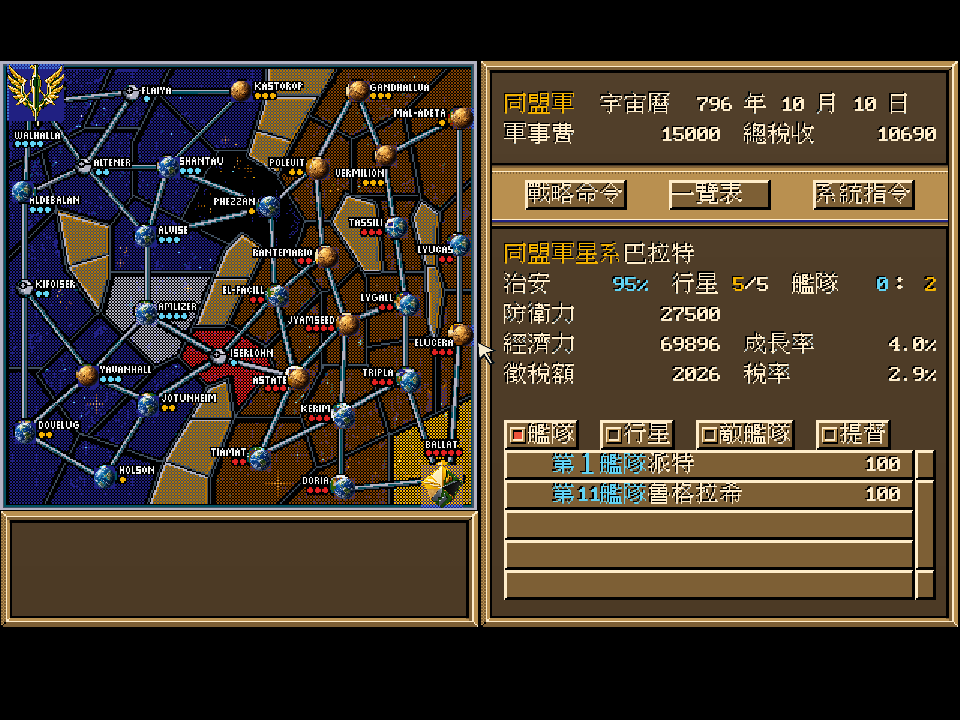
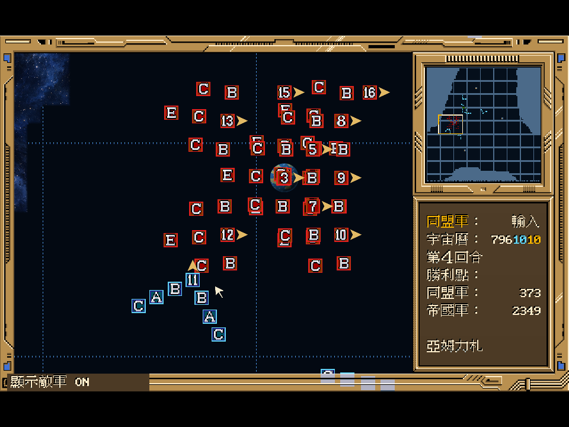
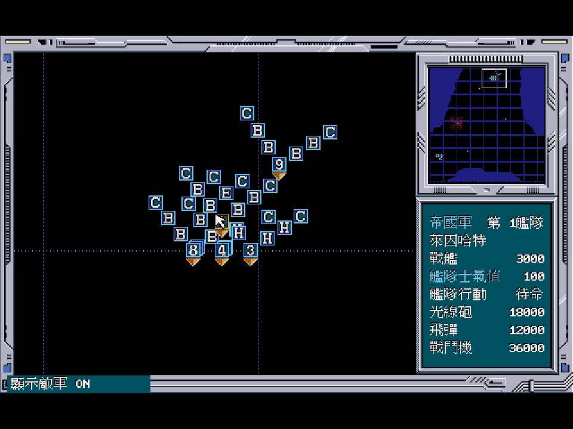
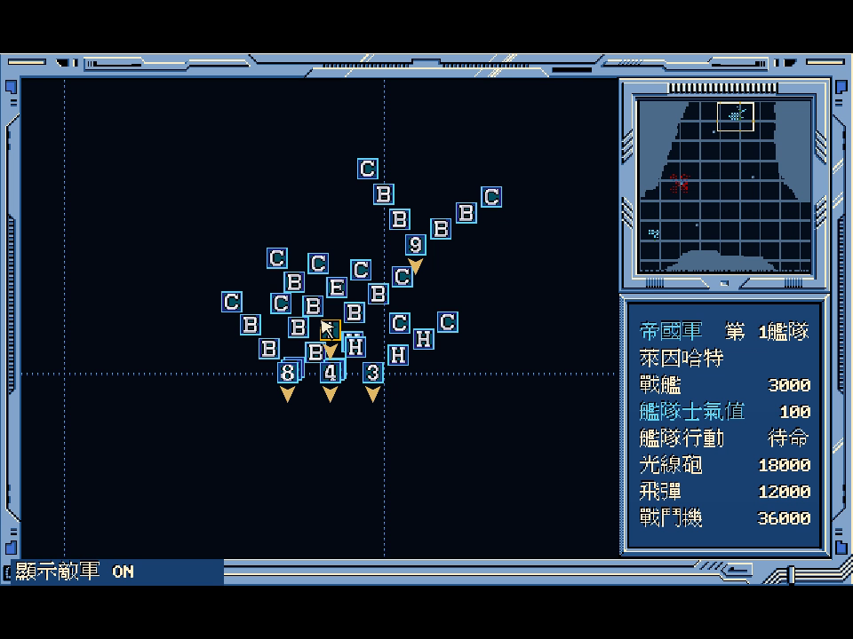
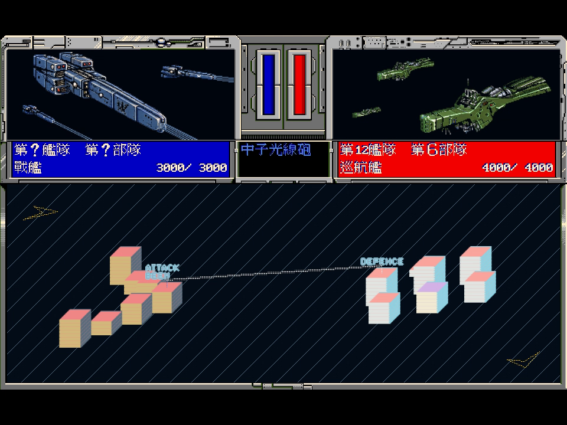
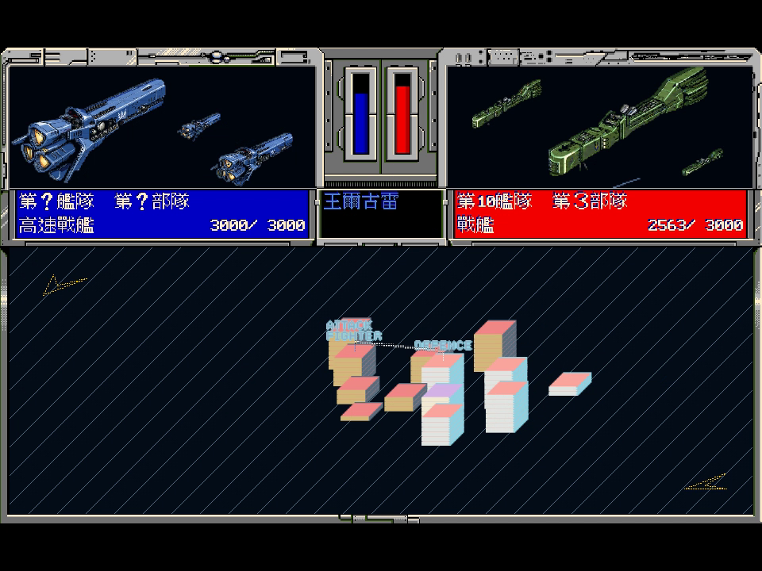

# 銀河英雄傳說 III SP remake

以 Go 與 Ebitengine 重製 1994 年 PC DOS 中文版，保留原版操作方式，加入陣營 HD 介面與強化 AI。

選擇銀河帝國或自由行星同盟，從財政、生產與提督任命安排戰略，再親自指揮艦隊迎戰。從亞姆力札會戰重新下令，讓你的戰術改變局勢。

**目前版本：[v.1.3.0-20261013](https://github.com/wicanr2/logh3/releases/tag/v.1.3.0-20261013)。** GitHub 提供引擎與程式來源，玩家須自備合法取得的原版遊戲資料。含遊戲資料的完整版與推廣影片僅保留本機，不加入 Git 或 Release 附件。

## 下載與本機完整版

| 平台 | GitHub 引擎包 |
|---|---|
| Windows amd64 | [下載 ZIP](https://github.com/wicanr2/logh3/releases/download/v.1.3.0-20261013/LOGH3-v.1.3.0-20261013-windows-amd64.zip) |
| Linux amd64 | [下載 ZIP](https://github.com/wicanr2/logh3/releases/download/v.1.3.0-20261013/LOGH3-v.1.3.0-20261013-linux-amd64.zip) |
| macOS Intel／Apple Silicon | [下載通用版 ZIP](https://github.com/wicanr2/logh3/releases/download/v.1.3.0-20261013/LOGH3-v.1.3.0-20261013-macos-universal.zip) |

[引擎來源包](https://github.com/wicanr2/logh3/releases/download/v.1.3.0-20261013/LOGH3-v.1.3.0-20261013-engine-source.tar.gz) · [SHA-256 校驗清單](https://github.com/wicanr2/logh3/releases/download/v.1.3.0-20261013/SHA256SUMS.txt) · [發行驗證](docs/playtest/120-system-dialog-polish.md)

本機交付保留於以下位置。`dist-all/` 已由 `.gitignore` 排除，不隨儲存庫下載。

| 本機內容 | 路徑 |
|---|---|
| 三平台完整版與啟動器 | `dist-all/v.1.3.0-20261013/full/` |
| 約 125 秒有聲推廣片與正常遊玩實錄 | `dist-all/v.1.2.0-20261012/promo/` |
| 封包、聲畫及發布驗證 | `dist-all/v.1.3.0-20261013/smoke/` |

既有 v.1.2.0 推廣片包含雙旗 HD 片頭、S1 讀檔、三個額外劇本、名將 AI 比較、F7 即時切換，以及約 52 秒正常速度艦隊交火。指定 1988 動畫片段的原生畫質為 480p，保留來源標示；成片與相關素材僅留本機。

## 主要特點

- **保留原版操作。** 維持 4:3 畫面、立體框線與按鈕位置，保留原版字形；修正確認、財政、訂造及建造操作，加入滑鼠停留反光。
- **兩套陣營 HD。** 帝國採藍金配色，同盟採赤焰戰線；戰略星圖重繪星球與徽章，保留星球名稱及航路。戰術地圖、人物與艦影支援 HD，部隊圖示保留原版細節。
- **隨時切換畫面。** F7 切換原版／HD，F1 開啟說明；滑鼠移到頂端可顯示功能列。顯示敵軍從設定選單切換，預設關閉。
- **強化戰略與戰術 AI。** 可選原版規則模式或四級強化難度；強化 AI 會集結兵力、協同移動並尋找包圍方向。
- **名將協同。** 楊威利採牽制與雙翼包抄，萊因哈特採集中突擊與側後封鎖。僅強化模式，兩人作為存活帶隊提督參戰時，所屬陣營全部艦隊的新移動額度為 1.5 倍，離場即解除。
- **三個額外劇本。** 取進度保留 S1「亞姆力札會戰」、S2「諸神的黃昏」、S3「巴米利恩會戰」，可正常載入及存讀。
- **四款字型。** 設定可選原版點陣、原版強化、思源宋體及思源黑體，預設原版強化。原版顯示固定使用原字形；新字集需另匯入，本機完整版已附。
- **原曲 HD 音色。** 本機完整版保留原曲，升級 11 首配樂的音色與混音；設定可切 HD／FM 或靜音。強化啟動器預設 HD，原版規則啟動器預設原音色。
- **啟動進度。** 小視窗顯示實際載入階段與人物圖張數，缺檔時顯示錯誤。讀檔與退出確認使用即時游標；主選單讀檔取消回主選單。
- **有聲交火。** 支援遊戲配樂、艦隊音效與普通速度戰鬥動畫。引擎包需另匯入自有音訊與 HD 素材；原版規則模式、動畫時鐘及存檔格式保持。

## 遊戲畫面

新版載入與字型設定取自 v.1.3.0 的兩陣營正常 Linux 操作。[新版截圖來源](docs/images/readme-v130.json)保存來源與雜湊。


| 帝國思源宋體 | 同盟思源黑體 |
|---|---|
|  |  |

以下八張取自 v.1.2.0 Linux 正式程式的正常 S1 遊玩實錄，保留完整 960×720 視窗。[截圖來源與雜湊](docs/images/readme-v120.json)可核對程式、操作紀錄及影片時碼。

| 帝國藍金介面與星圖 | 同盟赤焰戰線介面與星圖 |
|---|---|
|  |  |

| 三個額外劇本 | 強化模式戰術戰場 |
|---|---|
|  |  |

| 原版顯示 | 同一戰場切回 HD |
|---|---|
|  |  |

| 中子光線砲交火 | 戰鬥機交火 |
|---|---|
|  |  |

## 怎麼跑

1. 下載並解壓對應平台的引擎包。
2. 找到自己原版資料中同時包含 `GIN3.COM`、`GRAPH.IMG`、`FACE.AMG` 的目錄，依下表放入引擎包。原始來源可另外保留。
3. 啟動原版規則或強化模式。防拷畫面輸入 `138`，按確認或 Enter。

| 平台 | 原版資料位置 | 原版規則／強化模式啟動器 |
|---|---|---|
| Windows | `gin3.exe` 旁的 `original/` | `start-original.cmd`／`start-enhanced.cmd` |
| Linux | `gin3` 旁的 `original/` | `start-original.sh`／`start-enhanced.sh` |
| macOS | `.app/Contents/Resources/original/` | `start-original.command`／`start-enhanced.command` |

Linux 也可直接指定既有原版資料目錄：

```sh
./start-enhanced.sh -orig "/path/to/game"
```

啟動器可加 `-music "/path/to/music"` 匯入自行準備的 OGG 配樂與音效；加 `-graphics hd -art "/path/to/art"` 使用自有 HD 素材。未匯入音訊時，引擎包保持安靜。本機完整版已附該次本機交付的素材。

| 操作 | 功能 |
|---|---|
| F1 | 說明 |
| F7 | 原版／HD 顯示切換 |
| 滑鼠移到頂端 | 顯示功能列 |
| 系統指令 → 設定 → 顯示敵軍 | 遊戲中開關敵軍顯示 |
| 系統指令 → 設定 → 介面字型 | 循環切換四款字型 |
| 系統指令 → 設定 → HD／FM | 切換配樂音色，需已匯入 HD 曲庫 |

Windows 存檔位於 `%APPDATA%\logh3\save`；Linux 位於 `$XDG_CONFIG_HOME/logh3/save`，未設定時使用 `~/.config/logh3/save`；macOS 位於 `~/Library/Application Support/logh3/save`。兩種 AI 模式共用存檔。字型與 HD 音色選擇僅本次執行有效，可用 `-font original|classic|serif|sans` 與 `-music-quality original|hd` 指定啟動值；HD 曲目放在配樂目錄的 `hd/`。

Linux 需要 X11 或 XWayland、OpenGL 與 ALSA；Windows 需要 OpenGL 驅動；macOS 最低版本為 11.0，尚未經 Apple 公證。詳細步驟與第三方聲明見包內 `README.txt`。

## 驗證範圍

正常玩家路徑已抽測讀檔、財政與生產操作、艦隊指令、戰場移動、交火、存讀及顯示切換。兩陣營的原版規則／強化模式從相同初始艦隊比較，兩位名將各有正常實戰錄影；普通速度演出的格序、音效閘門及結果時點另有收據。

本版 Linux 完整包已驗兩陣營正常讀檔取消、三劇本、存讀、四字型與音色切換；標準 19 套件通過。Windows 以 Wine 驗證，macOS 完成雙架構、依賴與 ARM 簽章檢查。Windows／macOS 真機、人耳與完整登陸／占領演出仍待驗證。HD 是重繪模式，不宣稱全遊戲與 DOS 原版逐像素或流程完全一致。

本版證據見[發行驗證120](docs/playtest/120-system-dialog-polish.md)，既有戰場與影片證據見[驗證119](docs/playtest/119-hero-ai-release-promo.md)。目前狀態以 [CONTEXT.md](CONTEXT.md)、[驗證矩陣](VERIFICATION-MATRIX.md)及 [GitHub worklist Issue](https://github.com/wicanr2/logh3/issues?q=label%3Aworklist)為準。

## 重製與保存

本專案同時保存台灣中文版的資料格式、規則、畫面與人物傳。逆向結論附原始定位與證據等級；原版畫面及流程對拍使用 [dosgolem](https://github.com/wicanr2/dosgolem)，規則層另有經差異測試的 C 參考實作。原版規則模式與重製新增功能分開記錄。

開發、測試與素材處理使用既有 Docker 工具鏈。將合法原版資料放入 `org_game/extracted/` 後：

```sh
tools/gui.sh build ./cmd/gin3
tools/gui.sh run ./cmd/gin3 -orig /orig -ai 1
tools/gui.sh test ./cmd/... ./internal/...
```

## 文件

| 入口 | 內容 |
|---|---|
| [CONTEXT.md](CONTEXT.md)／[驗證矩陣](VERIFICATION-MATRIX.md) | 目前狀態與驗證範圍 |
| [規格索引](docs/spec/000-README.md) | 規則、操作與驗收契約 |
| [逆向資料索引](docs/internals/00-README.md)／[調查紀錄](docs/re/) | 資料格式、演算法與原始證據 |
| [人物傳](docs/lore/character-biographies.md) | 原版人物經歷保存 |
| [試玩與交付](docs/playtest/) | 正常玩家路徑、畫面及封包收據 |
| [WORKLOG.md](WORKLOG.md)／[AGENTS.md](AGENTS.md) | 工作歷程與協作規範 |

## 授權

引擎採[復古重製 source-available 授權條款 1.0（RRSAL-1.0）](LICENSE)：非商業用途免費，允許修改與再散布；實況、影片與平台分潤明示允許，商業用途另洽。第三方工具與音色庫依各自授權。

此授權不涵蓋原版遊戲檔、素材、譯文及其轉檔產物。本專案為非官方重製，與原作權利人無隸屬關係。儲存庫維持私有；研究素材與畫面不隨引擎包散布，完整版及動畫影片僅保留本機。
