# 銀河英雄傳說 III SP remake

以 Go 與 Ebitengine 重製 1994 年 PC DOS 中文版，保留原版操作方式，加入陣營 HD 介面與強化 AI。

選擇銀河帝國或自由行星同盟，從財政、生產與提督任命安排戰略，再親自指揮艦隊迎戰。從亞姆力札會戰重新下令，讓你的戰術改變局勢。

**目前本機完整版為 v.1.6.4-20261031。** P索敵顯示指揮P與範圍圈，指定位置後回到原視窗；敵我行軍改為整隊下令。圖片按需載入，發行人物圖預縮，保留原始HD。Windows ZIP、Linux AppImage與macOS通用ZIP均包含三組銀河海報及五語名言輪替。[本次封包與影片驗收](docs/playtest/142-v164-full-scout-march-promo.md) · [海報與語系](#海報與語系)

完整版也包含滑鼠重繪延遲與按鈕、下拉選項的hover修正。滑鼠移至頂端後，可從工具列直接切換思源黑體等既有字型及戰略AI。[操作驗收](docs/playtest/134-pointer-toolbar.md)

GitHub 公開引擎仍為 [v.1.5.0-20261019](https://github.com/wicanr2/logh3/releases/tag/v.1.5.0-20261019)，玩家須自備合法取得的原版遊戲資料。新版完整版與含原版音畫的推廣影片保留本機，不加入公開 Release 附件。

前線駐留後再出擊會從提督所在地領船、退船及編成。參謀／副官選人視窗的重複繪製已改善；新增預設關閉的「非戰艦旗艦」，開啟後修護艦E與運補艦T仍不能擔任旗艦。[前線與旗艦驗收](docs/playtest/132-garrison-flagship-promo.md)

戰術存檔成功後可回原戰場，讀檔重建同一戰場仍待完成。HD與新增規則不宣稱全遊戲DOS同狀態一致。[驗證範圍](#驗證範圍)

## 故事背景

遙遠的未來，人類已將生活圈擴展到銀河。實行專制政治的銀河帝國與奉行民主制度的自由行星同盟，持續交戰長達一百五十年。帝國受門閥貴族的腐敗侵蝕，同盟也陷入政客操弄與長年戰爭的消耗。兩位軍事天才的崛起，開始改變這場僵局。[世界觀來源：Production I.G 故事介紹](https://www.production-ig.co.jp/works/ginei/story.html)

帝國的萊因哈特因姊姊被皇帝納入後宮，決心與摯友吉爾菲艾斯奪取權力，進而追求統一宇宙。同盟的楊威利原本立志成為歷史學家，卻以靈活的戰術屢次挽救戰局。他被稱為「不敗的楊」與「魔術師楊」，心中盼望的仍是和平。兩人各自率領艦隊，在戰場上成為彼此最難戰勝的對手。[人物設定來源：原版人物傳](docs/lore/character-biographies.md)

亞姆力札會戰是這段歷史的重要轉折。同盟軍大舉進攻帝國領土，卻因補給困境與萊因哈特的反攻陷入危局，雙方艦隊最終集結於亞姆力札星域。[會戰背景來源：動畫本傳第 12 至 15 話介紹](https://ginei.jp/story1.php)

本作讓玩家接手兩大陣營的軍政與艦隊指揮，從亞姆力札會戰等局面重新作出選擇。人物的理想與衝突構成故事背景，戰局則交由玩家的部署、補給與臨場指揮決定。

## 下載與本機完整版

| 平台 | GitHub 引擎包 |
|---|---|
| Windows amd64 | [下載 ZIP](https://github.com/wicanr2/logh3/releases/download/v.1.5.0-20261019/LOGH3-v.1.5.0-20261019-windows-amd64.zip) |
| Linux amd64 | [下載 ZIP](https://github.com/wicanr2/logh3/releases/download/v.1.5.0-20261019/LOGH3-v.1.5.0-20261019-linux-amd64.zip) |
| macOS Intel／Apple Silicon | [下載通用版 ZIP](https://github.com/wicanr2/logh3/releases/download/v.1.5.0-20261019/LOGH3-v.1.5.0-20261019-macos-universal.zip) |

[引擎來源包](https://github.com/wicanr2/logh3/releases/download/v.1.5.0-20261019/LOGH3-v.1.5.0-20261019-engine-source.tar.gz) · [SHA-256 校驗清單](https://github.com/wicanr2/logh3/releases/download/v.1.5.0-20261019/SHA256SUMS.txt) · [封包與截圖驗收](docs/playtest/131-admiral-editor-delivery.md) · [公開下載核對](docs/internals/data/v150-release.json)

三平台引擎包均含提督編輯器、全軍攻擊加成，以及提督／參謀提供的戰鬥機攻擊加成。

本機交付保留於以下位置。`dist-all/` 已由 `.gitignore` 排除，不隨儲存庫下載。

| 本機內容 | 路徑 |
|---|---|
| 三平台 v.1.6.4 完整版，Linux為AppImage | `dist-all/v.1.6.4-20261031/full/` |
| v.1.6.4 完整故事推廣片 | `dist-all/v.1.6.4-20261031/promo/` |
| 三平台 v.1.5.0 公開引擎、來源與校驗檔 | `dist-all/v.1.5.0-20261019/release/` |

Linux AppImage包含完整素材，設為可執行後即可啟動；存檔沿原本的XDG設定目錄。沒有FUSE時可加`--appimage-extract-and-run`。[Linux操作與相容範圍](docs/playtest/135-v161-full-appimage.md)

完整推廣片以帝國與同盟國徽作底圖，從百年對峙、雙主角與亞姆力札危局，接到玩家的前線部署。本版補錄P索敵、選點返回與實際隊形行軍，也重錄駐地更換提督、領船與出擊。海報、五語展示、主角動畫、兩軍戰場、要塞砲與三種武器交火沿用已驗來源。操作保持原速，全片使用同一首BGM_0F連續配樂。本機檔名為 `LOGH3-v.1.6.4-20261031-promo.mp4`。[影片、來源與音軌驗收](docs/playtest/142-v164-full-scout-march-promo.md)

以下為v1.6.4正式AppImage正常入口的完整視窗。P索敵圈可隨選點視野移動；行軍圖取自實際移動結束時刻。[截圖來源與雜湊](docs/images/readme-v164.json)

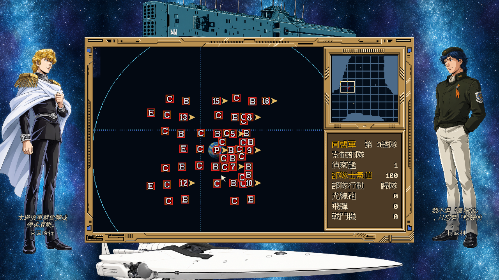

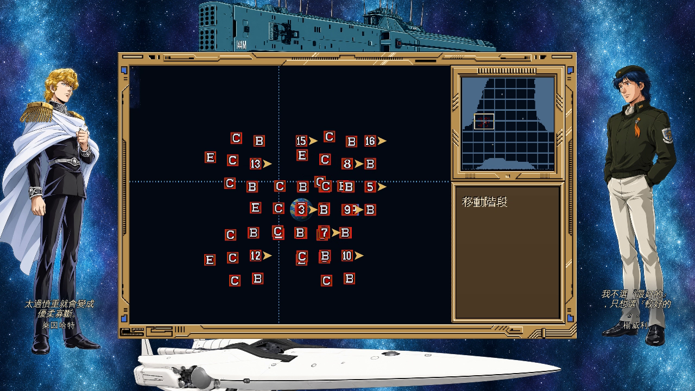

## 主要特點

- **保留原版操作。** 維持 4:3 畫面、立體框線、按鈕位置與原版字形，支援滑鼠停留反光。
- **三組海報與五語介面。** 可選雙主角、兩軍將領及親友群像。v1底部斜體名言跟隨語系，左右海報不接受遊戲操作；中央完整4:3，海報預設關閉。
- **上下單艦裝飾。** 海報開啟時，上方休伯利安朝左，下方伯倫希爾朝右，與兩側人物共用銀河背景。船體固定，只循環短光束；關閉動畫時保留靜態構圖。
- **兩套陣營 HD。** 帝國採藍金配色，同盟採赤焰戰線；戰略星圖重繪星球與徽章，保留星球名稱及航路。戰術地圖、人物與艦影支援 HD，部隊圖示保留原版細節。
- **隨時切換畫面。** F7 切換原版／HD，F1 開啟說明；滑鼠移到頂端可顯示功能列，直接調整介面字型與戰略AI。顯示敵軍從設定選單切換，預設關閉。
- **強化戰略與戰術 AI。** 可選原版規則模式或四級強化難度；強化 AI 會集結兵力、協同移動並尋找包圍方向。
- **轉移旗艦。** 旗艦分隊被擊毀時，謬拉必定轉移，其餘提督約25%。預設須有存活戰艦或高速戰艦；開啟「非戰艦旗艦」後可轉至其他存活艦種，E／T仍排除。轉往艘數最多的候選分隊，保留提督與副官。可在系統設定關閉。
- **名將協同。** 楊威利採牽制與雙翼包抄，萊因哈特採集中突擊與側後封鎖。僅強化模式，兩人作為存活帶隊提督參戰時，所屬陣營全部艦隊的新移動額度為 1.5 倍，離場即解除。「名將移動加成」可獨立關閉，仍保留名將戰術 AI。
- **提督能力編輯。** 可編輯十三項能力與四項特殊能力。兩位名將全軍攻擊預設+30%；坎普、波布蘭任提督或參謀時，本艦隊戰鬥機攻擊預設+30%。攻擊加成限強化模式，數值可調整並全局保存。
- **三個額外劇本。** 取進度保留 S1「亞姆力札會戰」、S2「諸神的黃昏」、S3「巴米利恩會戰」，可正常載入及存讀。
- **四款字型。** 工具列或設定可選原版點陣、原版強化、思源宋體及思源黑體，預設原版強化。原版顯示固定使用原字形；新字集需另匯入，本機完整版已附。
- **原曲 HD 音色。** 本機完整版保留原曲，升級 11 首配樂的音色與混音；設定可切 HD／FM 或靜音。強化啟動器預設 HD，原版規則啟動器預設原音色。
- **啟動進度。** 小視窗顯示實際載入階段與人物圖張數，缺檔時顯示錯誤。
- **有聲交火。** 支援遊戲配樂、艦隊音效與普通速度戰鬥動畫。引擎包需另匯入自有音訊與 HD 素材；原版規則模式、動畫時鐘及存檔格式保持。

## 系統設定與可選規則

從「系統指令 → 設定」調整敵軍顯示、AI模式、音色與可選規則。左上Lang切換語系，右上海報鈕切換組別，另有「編輯提督」入口。顯示敵軍、海報與非戰艦旗艦預設關閉；轉移旗艦與名將移動加成預設開啟，退出重開後保留選擇。

**設定頁小字與邊框已強化。** 設定頁採專用黑體字形，HD 使用高解析遮罩，移除小字陰影，選取項目改用深字配亮底。視窗新增可見金屬外緣，內側保留立體陰影。「介面字型」仍可切換其他遊戲畫面的四款字型。三平台 v.1.4.0 完整版與引擎包均已納入本次更新。[字型與邊框驗收](docs/playtest/129-clear-settings-font.md)

以下設定頁取自v1.6.3正式AppImage正常操作，手動開啟海報，非戰艦旗艦仍為預設關閉。保留完整1280×720視窗。[新版截圖來源與雜湊](docs/images/readme-v163.json)

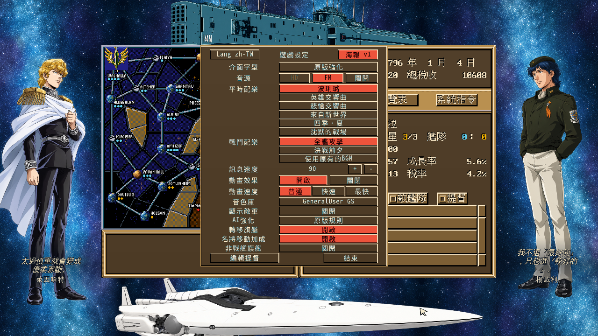


下方為v1.5.0正式包錄影前手動開啟顯示敵軍的實際戰場。[來源與功能驗收](docs/playtest/131-admiral-editor-delivery.md)


「顯示敵軍」只改變畫面；開關後戰場回合、部隊與鏡頭保持。AI 可選原版與強化 0 至 3，沿啟動器的初始模式，本次執行有效，影響之後的決策。

| 選項 | 開啟時 | 關閉時 |
|---|---|---|
| 轉移旗艦 | 旗艦分隊被擊毀後，謬拉100%、其他提督約25%機率轉移。須有同艦隊存活的戰艦或高速戰艦，選艘數最多的分隊，保留提督與副官 | 沿原本旗艦全滅判定，不額外擲轉移機率 |
| 名將移動加成 | 僅強化模式，存活帶隊的萊因哈特或楊威利參戰時，所屬陣營的新移動額度為1.5倍 | 恢復一般新移動額度，仍保留兩人的戰術AI |
| 非戰艦旗艦 | 編成與擊破轉移可選B／H／C／A／D，修護艦E與運補艦T排除 | 旗艦仍限戰艦與高速戰艦；預設關閉 |

轉移旗艦每次擊毀只判定一次，失敗不重擲。轉移使用現有分隊，不增加艦艇、不回補彈藥。新旗艦若再次被擊毀，才有下一次轉移機會。這是可選的 remake 擴充規則。

這些選項保存於玩家存檔目錄的 `preferences.json`，不改原版六表存檔格式。名將移動開關影響之後取得的新額度，不回溯改動本回合已取得的額度。

## 海報與語系

設定頁右上的海報鈕依序切換「關閉 → v1 → v2 → v3」。首次啟動預設關閉，組別與語系會保存。缺少圖片時保留可用組別；海報全部不可用時回到原本4:3。

三平台完整版已套用核准構圖。以下三圖取自v1.6.3正式AppImage正常遊玩入口，保留完整1280×720視窗。[定案HTML](docs/spec/157-poster-galaxy-frame.html) · [本次封包驗收](docs/playtest/139-poster-frame-full-promo.md) · [截圖來源與雜湊](docs/images/readme-v163.json)

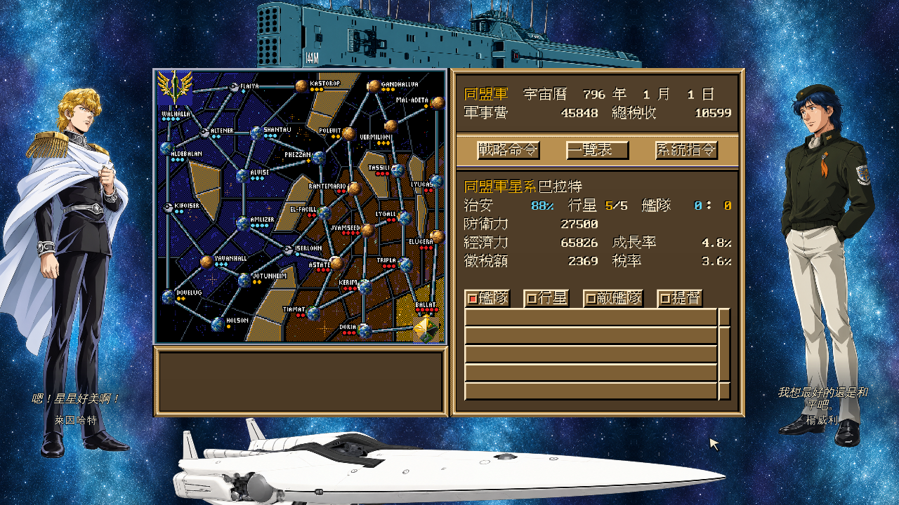

v1的兩人名言每60秒同步換一組，五組循環。切換語系時保留當前組別；重開遊戲由第一組開始。文字與姓名保持在人物圖片內，長句向上排。語錄採已同意的網路轉錄及本專案譯文，尚未逐字核對尖端舊版，不稱官方譯文。[五組清單與來源](tools/scripts/poster_quote_candidates.json) · [驗證與截圖雜湊](docs/playtest/138-poster-quote-rotation.md)

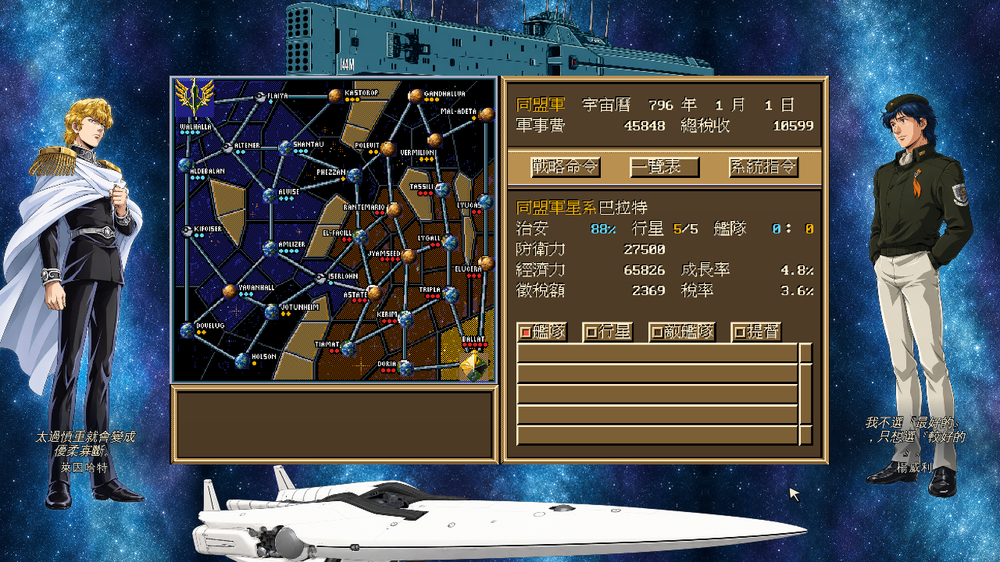

| v2兩軍將領 | v3雙方親友 |
|---|---|
| [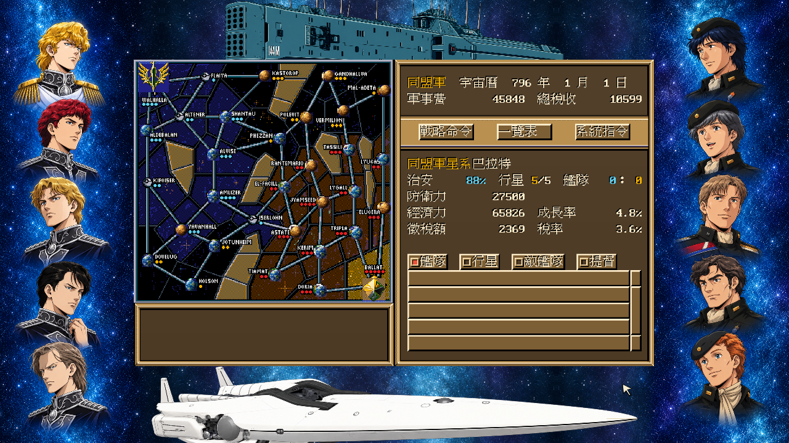](docs/images/readme-v163-poster-v2.png) | [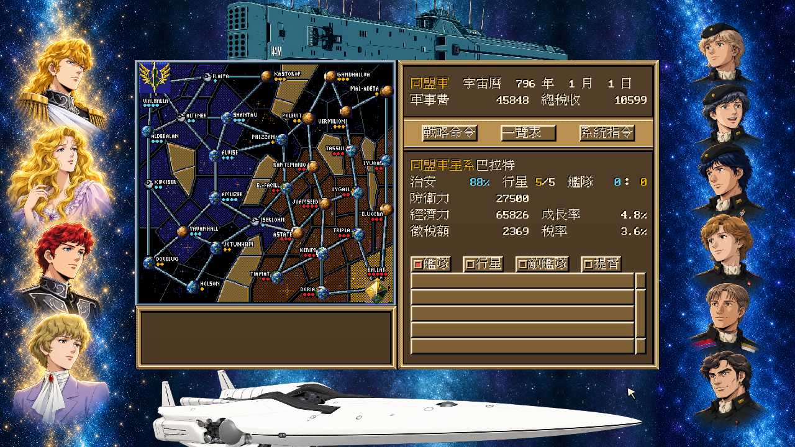](docs/images/readme-v163-poster-v3.png) |

| 組別 | 左側帝國 | 右側同盟 |
|---|---|---|
| v1 | 萊因哈特 | 楊威利 |
| v2 | 萊因哈特、齊格飛、米達麥亞、羅嚴塔爾、奧貝斯坦 | 楊威利、亞典波羅、卡介倫、先寇布、波布蘭 |
| v3 | 萊因哈特、安妮羅潔、齊格飛、希爾德 | 楊威利、菲列特利加、尤里安、卡介倫、亞典波羅、先寇布 |

左上Lang按鈕切換 `zh-TW`、`zh-CN`、`ja`、`en`、`ko`。五語共用操作位置、遊戲資料與存檔；v1名言同步切換。譯表為[UTF-8 TSV](internal/localize/ui.tsv)，完整版可編輯 `data/ui-locales.tsv` 後重啟。圖片內商標、故事圖片及未收錄原文保留，不把這些內容宣稱為完整翻譯。

| 简体中文 | 日本語 |
|---|---|
| [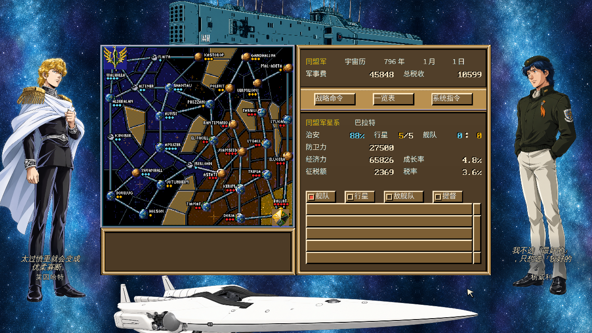](docs/images/readme-v163-locale-zh-CN.png) | [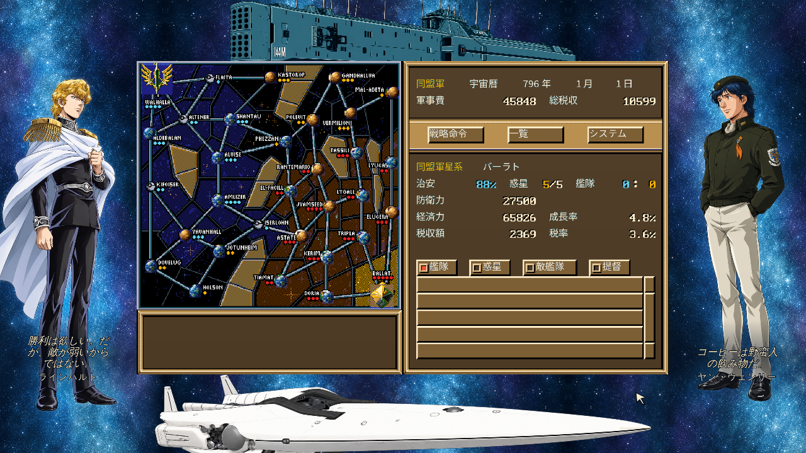](docs/images/readme-v163-locale-ja.png) |

| English | 한국어 |
|---|---|
| [](docs/images/readme-v163-locale-en.png) | [](docs/images/readme-v163-locale-ko.png) |

以上海報與五語畫面皆為v1.6.3實際完整版正常操作，未縮放完整視窗。人物造型參考經典動畫官方資料，海報為重構美術；四語名言為本專案翻譯，非官方字幕。[規格與來源](docs/spec/152-poster-sets-and-quotes.md) · [截圖來源與雜湊](docs/images/readme-v163.json)

## 提督能力編輯器

從「系統指令 → 設定 → 編輯提督」開啟，支援帝國40位、同盟42位將領。介面沿用兩陣營配色、立體框與人物頭像，分為基本、內部、特殊能力三頁。

| 分頁 | 可編輯項目 |
|---|---|
| 基本能力 | 統率力、移動、回轉、營運、光線砲、飛彈、戰鬥機、防禦、占領、運用 |
| 內部能力 | 內政／應變參數、稅務／決策權重、目標選擇判斷。這些是依用途取的標籤，原版欄名未知，詳見[三項能力調查](docs/internals/08-admiral-dt.md#沒有名字那三格在做什麼) |
| 特殊能力 | 旗艦擊毀換艦率、全軍移動加成、全軍攻擊加成、本艦隊戰鬥機攻擊加成 |

**光線砲、飛彈與戰鬥機可分別修改。** 改的是原版武器能力值，參與攻擊及防禦公式；沒有獨立的命中率或射擊頻率欄位。十三項能力可設1至200，現行艦種資料下三項武器能力最低為3。等級、功績、陣營、人物狀態、參謀任命、位置與艦艇裝備／彈藥尚未開放編輯。

| 特殊能力 | 預設與作用範圍 |
|---|---|
| 旗艦擊毀換艦率 | 謬拉100%，其他25%；可設0至100%，須開啟「轉移旗艦」 |
| 全軍移動加成 | 萊因哈特、楊威利各+50%，其他0%；須為存活在場的帶隊提督，並開啟「名將移動加成」 |
| 全軍攻擊加成 | 萊因哈特、楊威利各+30%，其他0%；須為存活在場的帶隊提督 |
| 本艦隊戰鬥機攻擊 | 坎普、波布蘭各+30%，其他0%；擔任提督或參謀均生效，只加強所在艦隊的戰鬥機 |

三項攻擊／移動增幅均可設0至200%，只在強化模式生效。全軍加成取同陣營最高值；戰鬥機加成取該艦隊提督與參謀的較高值。全軍攻擊與戰鬥機倍率各自乘算，例如兩者均+30%時為1.3×1.3。攻擊增幅只作用於戰術艦隊交火，不增加彈藥、射程或動畫速度，也不影響要塞砲、行星反擊與戰略自動攻城。

點數值可直接輸入，也可用「−／+」微調。「套用變更」會保存全局設定，立即套用目前遊戲，並於重啟、新遊戲及讀檔後繼續套用。只有編輯過的能力持續覆寫，其餘保留劇本、存檔與升級結果。「取消」放棄未套用修改；「還原本提督」恢復該人的預設能力。設定保存在存檔目錄的 `preferences.json`，原版六表格式保持。

以下繁體中文基本與特殊能力畫面取自v1.6.3正式AppImage，完整1280×720視窗含海報。內部能力與個別將領保留v1.5.0實錄，英文及韓文編輯器保留v1.6.0實錄。[功能驗收](docs/playtest/130-admiral-editor.md) · [新版來源雜湊](docs/images/readme-v163.json) · [v1.5.0來源雜湊](docs/images/readme-v150.json) · [v1.6.0來源雜湊](docs/images/readme-v160.json)

| 基本能力 | 三項內部能力 |
|---|---|
| 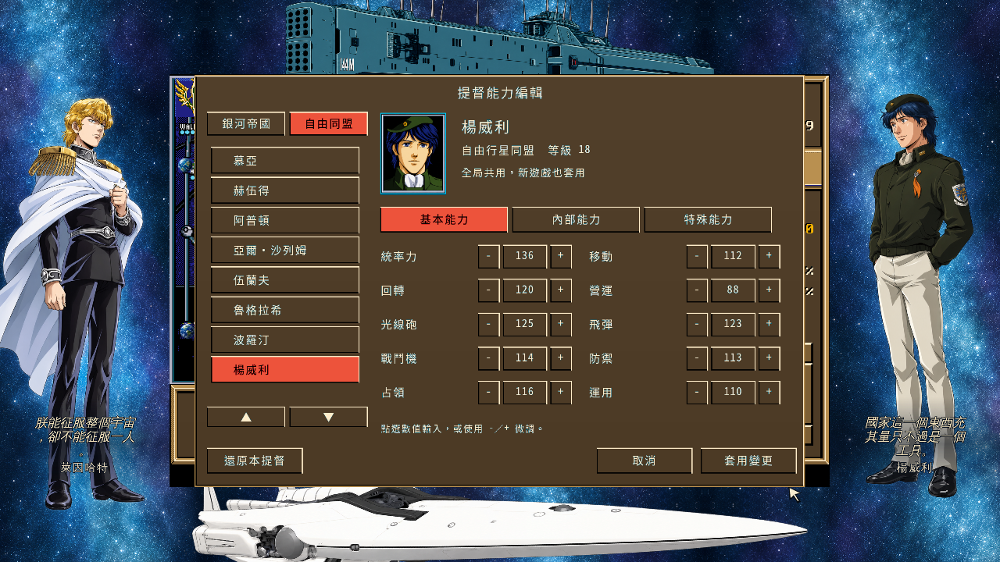 |  |

| v1.6.3特殊能力 | English（v1.6.0） |
|---|---|
| 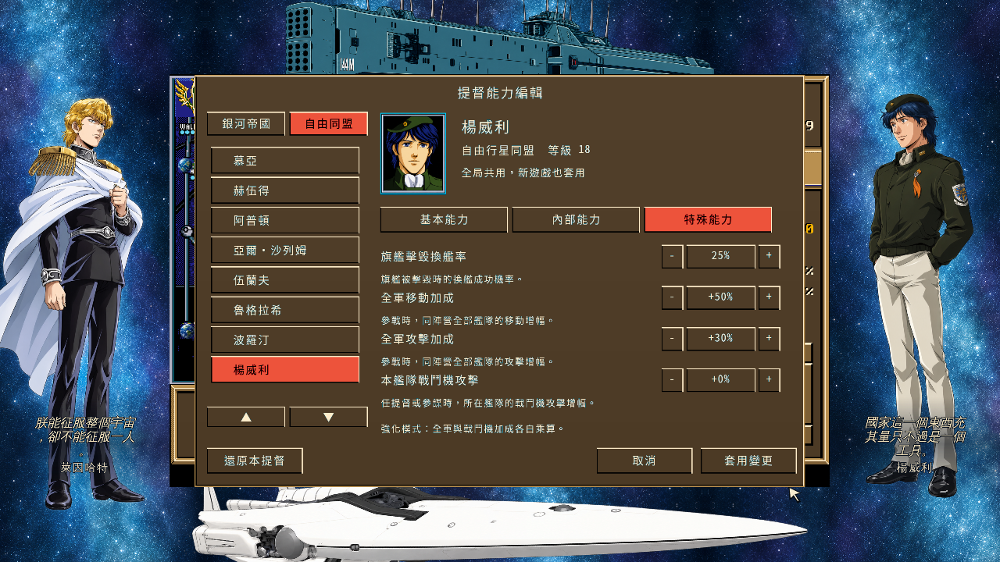 | 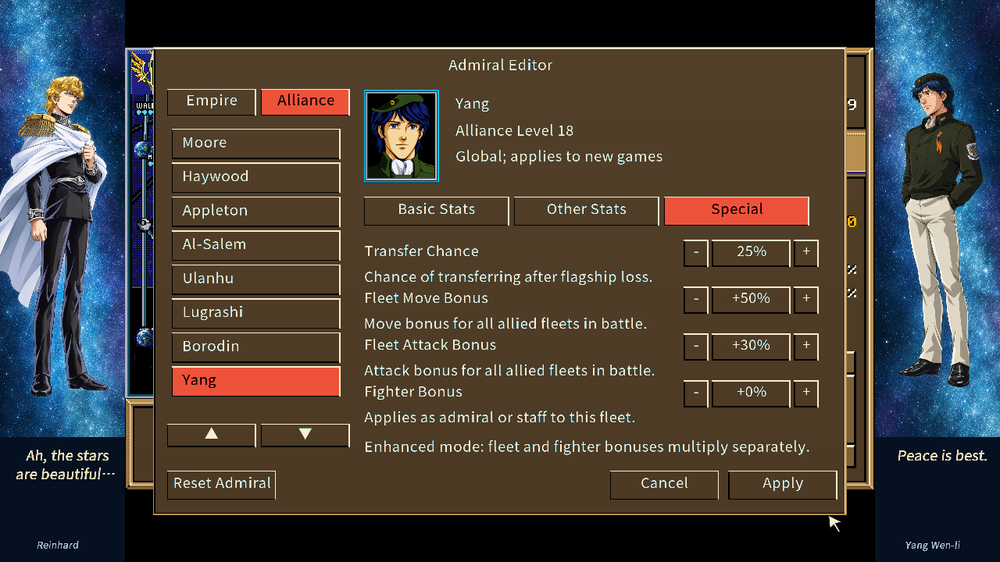 |

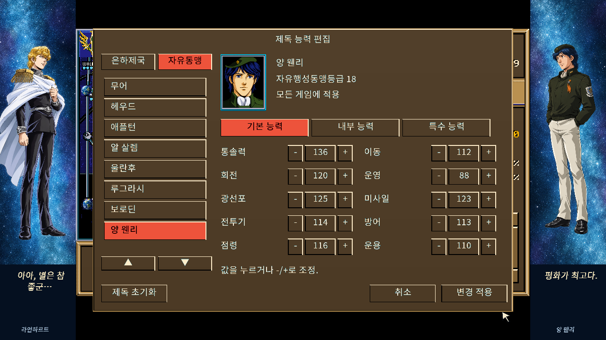

| 帝國提督編輯 | 同盟提督編輯 |
|---|---|
|  |  |

| 坎普戰鬥機加成 | 波布蘭戰鬥機加成 |
|---|---|
|  |  |

## 遊戲畫面

### 將領頭像總覽

帝國 40 位、同盟 42 位將領，原版與 HD 使用相同排列，姓名沿用原版。點圖可查看完整總覽。[圖片來源與雜湊](docs/images/readme-admirals.json) · [總覽產生器](tools/scripts/readme_portrait_overviews.py)

| 銀河帝國原版 | 銀河帝國 HD |
|---|---|
| [](docs/images/readme-admirals-empire-original.png) | [](docs/images/readme-admirals-empire-hd.png) |

| 自由行星同盟原版 | 自由行星同盟 HD |
|---|---|
| [](docs/images/readme-admirals-alliance-original.png) | [](docs/images/readme-admirals-alliance-hd.png) |

### 遊戲實錄

載入進度畫面取自 v.1.3.0 Linux 版；目前設定頁見上方新版截圖。[載入截圖來源與雜湊](docs/images/readme-v130.json)


以下兩張星圖為v1.6.0 Linux完整ZIP正常S1遊玩，保留完整1280×720視窗。[新版截圖來源與雜湊](docs/images/readme-v160.json)

| 帝國藍金介面與星圖 | 同盟赤焰戰線介面與星圖 |
|---|---|
| 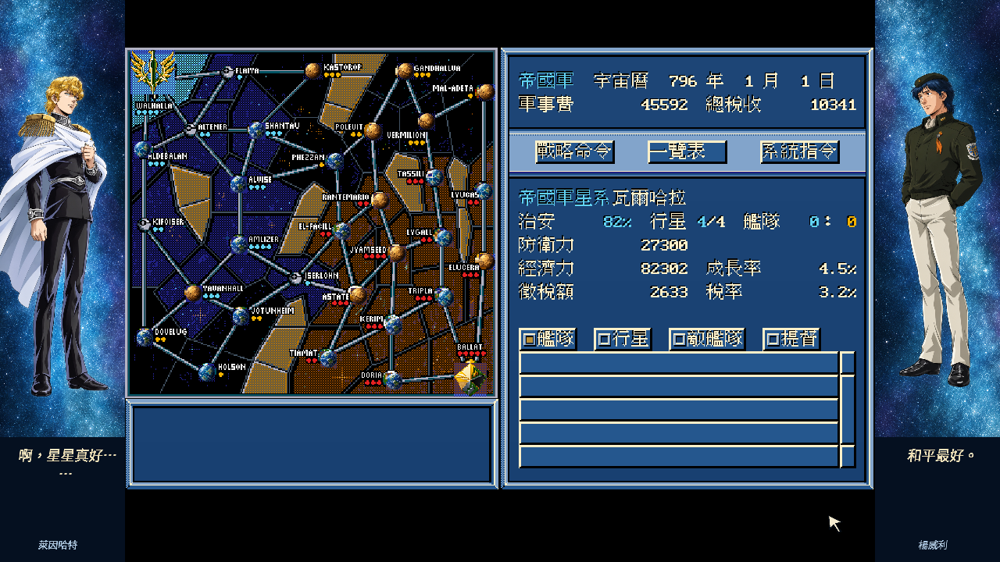 |  |

以下三張取自同一局前線駐留後的實際操作，依序改選提督、查看當地船艦並完成編成。母星船艦庫存保持，重新組成的艦隊從駐地出發。[操作與存檔驗收](docs/playtest/133-poster-five-language-delivery.md)

| 駐地改選提督 | 當地船艦庫存 |
|---|---|
| 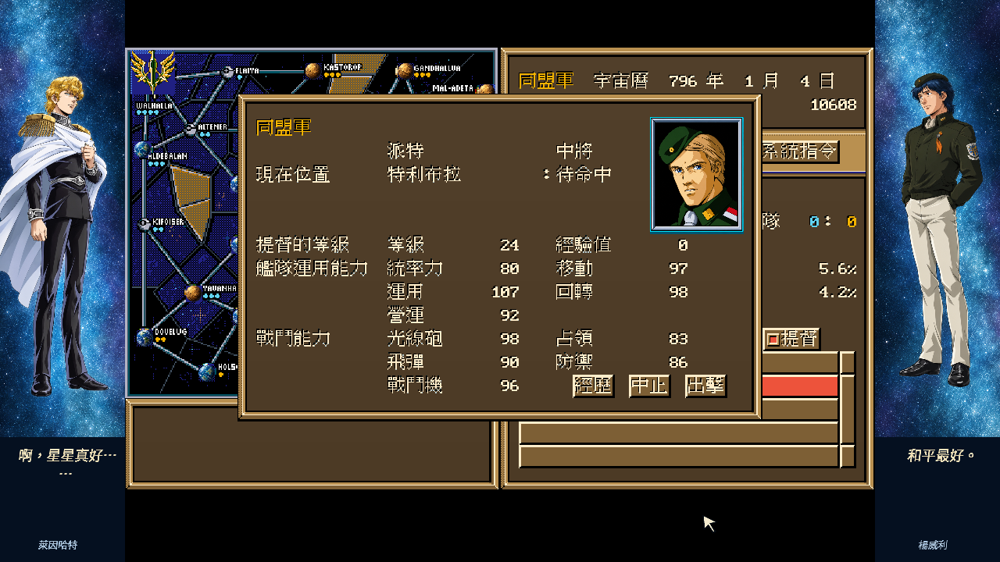 | 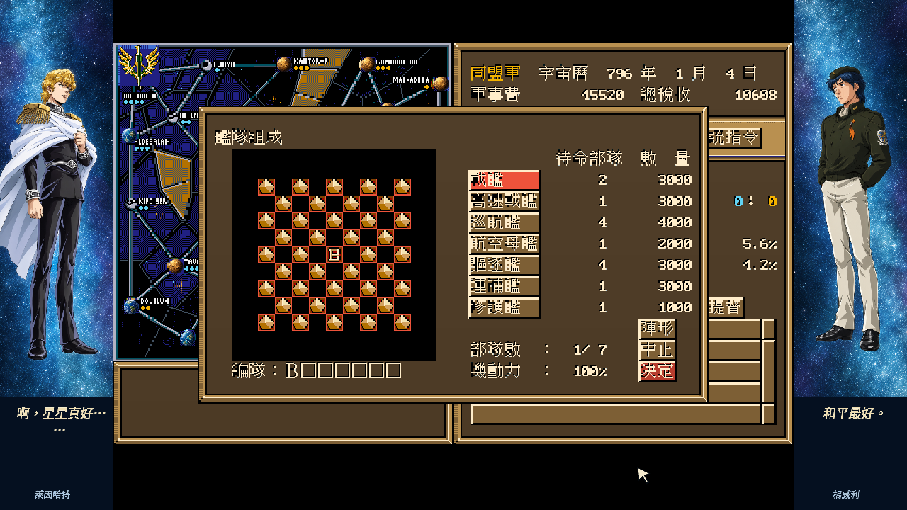 |

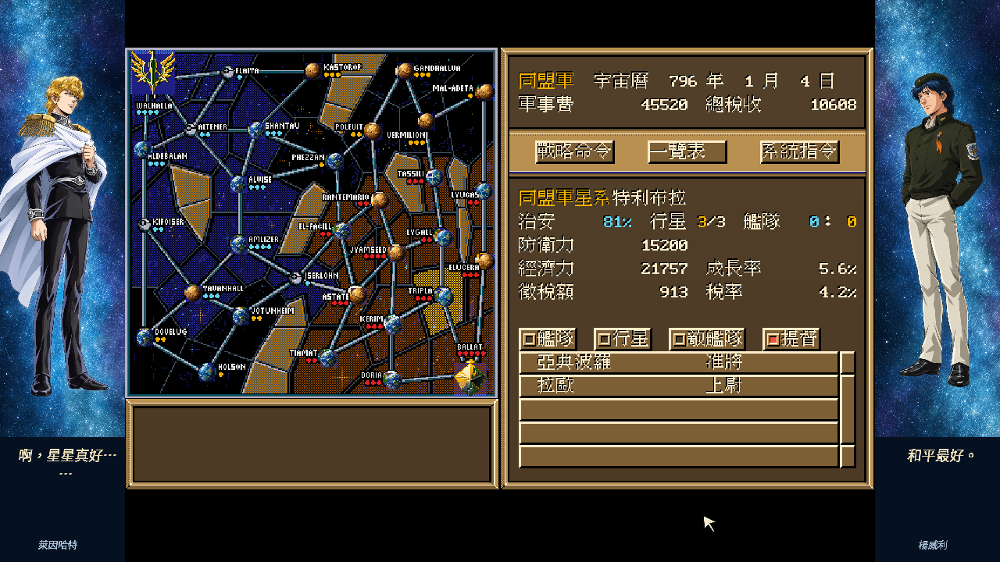

以下劇本、戰術與交火保留v1.5.0正式包的完整960×720實錄，交火取自同次原速錄影。[v1.5.0截圖來源與雜湊](docs/images/readme-v150.json)

| 三個額外劇本 | 強化模式戰術戰場 |
|---|---|
|  |  |

| 編輯器原版顯示 | 同一編輯狀態切回 HD |
|---|---|
|  |  |

| 中子光線砲交火 | 戰鬥機交火 |
|---|---|
|  |  |

[帝國戰場實錄](docs/images/readme-v150-battle-empire.png)與[飛彈交火實錄](docs/images/readme-v150-missile.png)也取自同批正式包。

## 怎麼跑

1. 下載並解壓對應平台的引擎包。
2. 找到自己原版資料中同時包含 `GIN3.COM`、`GRAPH.IMG`、`FACE.AMG` 的目錄，依下表放入引擎包。原始來源可另外保留。
3. 啟動原版規則或強化模式。防拷畫面輸入 `138`，按確認或 Enter。

| 平台 | 原版資料位置 | 原版規則／強化模式啟動器 |
|---|---|---|
| Windows | `gin3.exe` 旁的 `original/` | `start-original.cmd`／`start-enhanced.cmd`；本機修正版亦可直接雙擊 `gin3.exe` |
| Linux | `gin3` 旁的 `original/` | `start-original.sh`／`start-enhanced.sh` |
| macOS | `.app/Contents/Resources/original/` | `start-original.command`／`start-enhanced.command` |

Linux 也可直接指定既有原版資料目錄：

```sh
./start-enhanced.sh -orig "/path/to/game"
```

啟動器可加 `-music "/path/to/music"` 匯入自行準備的 OGG 配樂與音效；加 `-graphics hd -art "/path/to/art"` 使用自有 HD 素材。未匯入音訊時，引擎包保持安靜。本機完整版已附該次本機交付的素材。

| 操作 | 功能 |
|---|---|
| F1 | 說明 |
| F7 | 原版／HD 顯示切換 |
| 滑鼠移到頂端 | 顯示功能列 |
| 系統指令 → 設定 → 顯示敵軍 | 遊戲中開關敵軍顯示 |
| 系統指令 → 設定 → AI強化 | 選擇原版規則或強化0至3 |
| 系統指令 → 設定 → 介面字型 | 循環切換四款字型 |
| 系統指令 → 設定 → HD／FM | 切換配樂音色，需已匯入 HD 曲庫 |
| 系統指令 → 設定 → 音色庫 | 選擇 GeneralUser GS 或 Roland MT-32 |
| 系統指令 → 設定 → 轉移旗艦 | 開關旗艦擊毀後的轉移規則，預設開啟 |
| 系統指令 → 設定 → 名將移動加成 | 開關強化模式的名將陣營移動加成，預設開啟 |
| 系統指令 → 設定 → 編輯提督 | 修改十三項能力與四項特殊能力，全局保存 |
| 系統指令 → 設定 → 非戰艦旗艦 | 開關B／H以外旗艦，E／T排除，預設關閉 |
| 系統指令 → 設定 → 海報 | 關閉、v1、v2、v3循環，預設關閉 |
| 系統指令 → 設定 → Lang | 繁體、簡體、日文、英文、韓語循環，介面與名言同步 |

Windows 存檔位於 `%APPDATA%\logh3\save`；Linux 位於 `$XDG_CONFIG_HOME/logh3/save`，未設定時使用 `~/.config/logh3/save`；macOS 位於 `~/Library/Application Support/logh3/save`。兩種 AI 模式共用存檔。轉移旗艦、名將移動加成與 GeneralUser GS／Roland MT-32 音色選擇保存於同目錄的 `preferences.json`，不改原版六表格式。字型與 HD／FM 切換僅本次執行有效，可用 `-font original|classic|serif|sans` 與 `-music-quality original|hd` 指定啟動值；HD 曲目放在配樂目錄的 `hd/`。

Linux 需要 X11 或 XWayland、OpenGL 與 ALSA；Windows 需要 OpenGL 驅動；macOS 最低版本為 11.0，尚未經 Apple 公證。詳細步驟與第三方聲明見包內 `README.txt`。

## 驗證範圍

Linux 版已抽測兩陣營的讀檔、財政與生產、艦隊指令、戰場移動、交火、存讀，以及畫面、字型與音色切換。S3同盟已驗24段完整登陸／反擊／占領，兩種顯示各293來源格無漏格；普通／要塞行星459完整幀的原版渲染對拍零差。要塞砲另驗S1同盟正常演出及423完整幀，試射包含友軍傷害。現行音樂已通過使用者實際聆聽驗收。Windows 完成 Wine 驗證，macOS 完成雙架構、依賴與 ARM 簽章檢查。Windows／macOS 真機、DOS整回合同態及同戰場讀檔續戰仍未新增驗收。HD 是重繪模式，不宣稱全遊戲與 DOS 原版逐像素或流程完全一致。

v.1.5.0的七個封包、Linux與Windows Wine兩陣營正常編輯、19張新版截圖及本機推廣影片，見[新版交付驗收](docs/playtest/131-admiral-editor-delivery.md)。能力規則、取消／套用與全局保存另見[編輯器驗收](docs/playtest/130-admiral-editor.md)。它是 remake 擴充，不宣稱新增能力具有 DOS 原版一致性。

前版的字型與邊框驗證見[驗收129](docs/playtest/129-clear-settings-font.md)。目前狀態以 [CONTEXT.md](CONTEXT.md)、[驗證矩陣](VERIFICATION-MATRIX.md)及 [GitHub worklist Issue](https://github.com/wicanr2/logh3/issues?q=label%3Aworklist)為準。

## 重製與保存

本專案同時保存台灣中文版的資料格式、規則、畫面與人物傳。逆向結論附原始定位與證據等級；原版畫面及流程對拍使用 [dosgolem](https://github.com/wicanr2/dosgolem)，規則層另有經差異測試的 C 參考實作。原版規則模式與重製新增功能分開記錄。

開發與測試方式見 [AGENTS.md](AGENTS.md)，工作歷程見 [WORKLOG.md](WORKLOG.md)。

## 文件

| 入口 | 內容 |
|---|---|
| [CONTEXT.md](CONTEXT.md)／[驗證矩陣](VERIFICATION-MATRIX.md) | 目前狀態與驗證範圍 |
| [規格索引](docs/spec/000-README.md) | 規則、操作與驗收契約 |
| [逆向資料索引](docs/internals/00-README.md)／[調查紀錄](docs/re/) | 資料格式、演算法與原始證據 |
| [人物傳](docs/lore/character-biographies.md) | 原版人物經歷保存 |
| [試玩與交付](docs/playtest/) | 正常玩家路徑、畫面及封包收據 |
| [WORKLOG.md](WORKLOG.md) | 開發、驗證與交付歷程 |
| [AGENTS.md](AGENTS.md) | 開發方式與協作規範 |

## 授權

引擎採[復古重製 source-available 授權條款 1.0（RRSAL-1.0）](LICENSE)：非商業用途免費，允許修改與再散布；實況、影片與平台分潤明示允許，商業用途另洽。第三方工具與音色庫依各自授權。

此授權不涵蓋原版遊戲檔、素材、譯文及其轉檔產物。本專案為非官方重製，與原作權利人無隸屬關係。儲存庫保留解碼後的原版素材、研究畫面與 `decomp/` C 參考實作及其 Git 歷史，供研究與保存。引擎包不附原版素材；原始遊戲檔、完整版及動畫影片僅保留本機。
