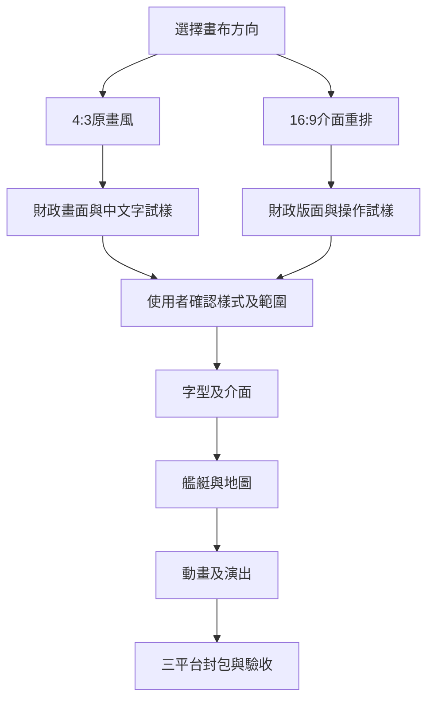

# 第122輪：v1.0.0交付與下一階段HD提案

狀態：待選方向。本頁是規劃交付，未核准的項目不進正式程式。v.1.0.0 的按鈕修正與封包交付不依賴此選擇。

本輪依使用者要求修正第二畫面與財政按鈕、打包release與完整版、製作推廣片，再規劃後續HD。開工遠端快照仍開放#97、#69、#66、#48、#16；#97按本次完整人物與正常操作驗收收尾，其餘原有項目保持範圍。使用者已明示授權更新本次相關Issue。這是當輪計畫快照，未完成權威仍為GitHub worklist。

## 已確認的起點

| 項目 | 已證實的現況 | 下一階段缺口 |
|---|---|---|
| 人物 | 82張修復人物與1張原版單色空格，原索引完整 | 放大後的局部特徵及跨畫面抽查，可逐張修正 |
| 顯示 | 640×480邏輯畫布，HD輸出1920×1440；維持4:3 | 目前文字與大多數素材仍由原像素展開 |
| 其他素材 | 三倍邊緣細化；33張跨類別樣本的邏輯中心及色號保持 | 尚未逐張重繪、重新製作字型或動畫 |
| 操作 | 原圖與HD共用邏輯座標；兩陣營與雙人正常視窗重播通過 | 新介面需重新驗繪製、命中、鍵盤與遮擋 |

來源：[123顯示契約](../spec/123-hd-complete-presentation.md)、[人物manifest](../../assets/hd/MANIFEST.json)、[本次驗收109](../playtest/109-v1-release.md)。素材數量來自實際匯出目錄，詳見本次來源索引的 `inventory`。它們是資源筆數，尚未等同獨立畫作或去重後工量。

## 先選方向

| 方向 | 效果與成本 | 建議 |
|---|---|---|
| 保留4:3與原畫風 | 沿現有畫面密度、流程及命中座標，分批替換素材；原圖模式可繼續作比較基準 | 優先採用，改動集中且容易驗收 |
| 改為16:9並重排 | 可放大文字及增加同時顯示的資訊；全部視窗、地圖視野、命中及輸入需重新定義 | 先完成一個介面試樣再裁決，工量不能沿用4:3估算 |

兩種方向均以保留現有規則與存檔為提案前提。選擇寬螢幕不自動授權增加地圖可見範圍、規則、動畫時間或新操作流程。

## 分階段工作與停止條件

| 階段 | 具體工作與交付物 | 過關條件 |
|---|---|---|
| 0：盤點與去重 | 按原索引建立素材依賴；分清共用圖塊、動畫幀與整張背景；保存原圖、輸出、工具及來源hash | 素材數量、格式及所有正式消費端對得上；未解碼項列unknown |
| 1：財政試樣 | 先做可丟棄的財政報告、預算與建造畫面；比較原字型與新字型、一般及最長字串、1.5與2倍視窗 | 使用者核准並保存定版圖；正常點擊、七列箭頭、結束與返回完整可用；未核准不擴批 |
| 2：字型及介面 | 字庫盤點Big5字碼及半形混排；重製面框、按鈕、游標與選單；單一幾何來源供繪製及命中 | 不漏字、不裁切；最長人物名、曲名及金額通過；鍵盤與滑鼠結果一致；原圖模式可回退 |
| 3：艦艇及地圖 | 優先75筆sprite、4組各128筆圖塊、32筆地圖；按艦型／地形共享來源，避免把共用素材重畫多次 | 一條正常戰略到戰術路徑涵蓋捲動、朝向、勢力色、遮擋及小地圖；原索引與規則保持 |
| 4：動畫及演出 | 1438筆comani、374筆intro、50筆vo5、3筆ani_pnl先分段與找關鍵幀，再製作幀間連續性 | 同一段內人物、艦型及光影連續；幀數、事件點、跳過、完成閘門有契約；缺少行為證據先停下查證 |
| 5：交付 | 補其餘面框、旗幟、標題及特殊圖；完成manifest、缺檔回退、三平台打包與短片 | 實際archive範圍、正常入口、存讀、視窗倍率及輸出身份通過；Windows／macOS真機另列驗收 |

先完成第0與第1階段，取得去重後工量及定版樣式，再排後續時程。現在不以資源筆數直接換算獨立畫作數量或完成日期。

## 製作與驗收界線

- 人物、艦艇、地圖與動畫分別記錄「重繪」「邊緣細化」「保留原圖」，覆蓋率分開計算。82張人物到齊不能稱整套HD完成。
- 新美術保留原始索引與來源；生成原檔、完整提示詞、工具版本及輸入／輸出SHA-256一起保存。已定版的圖片不重新生成覆蓋。
- 字型須先確認可隨引擎包散布的授權及Big5覆蓋。缺字、文字尺寸與baseline需用實際渲染量測。
- 每批至少驗一條「原資料→素材載入→正常UI→操作→存讀→回退」。靜態圖與診斷入口不能代替玩家路徑。
- 新介面或素材格式先走證據、DRAFT、審查、READY，再實作及驗收。沒有核准的版面或規則不補進正式路徑。
- 原版衍生圖像及音樂保持本機完整包邊界。對外素材、授權或公開方式如需改變，另請使用者裁決。

## 決策記錄

2026-10-10已提出4:3原畫風與16:9重排兩個方向，等待使用者選擇。下一個實作單位是財政試樣，不是立即重畫所有圖。新方向確認後更新本節，再將第一個試樣拆成可驗收規格。

入口：[正式交付109](../playtest/109-v1-release.md)、[專案索引](../internals/00-README.md)。
